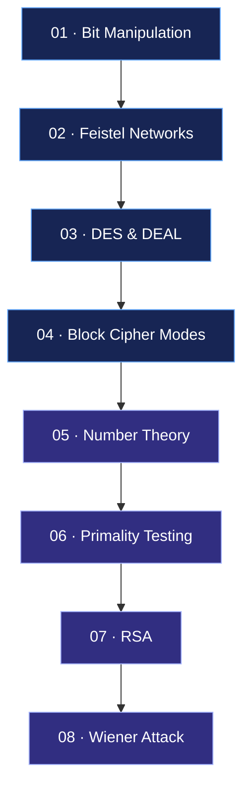

# Cryptography Labs

**Cryptography · Number Theory · Symmetric & Public-Key Encryption**

A collection of university laboratory assignments exploring cryptographic algorithms, mathematical foundations, software architecture, and practical encryption.

> From bit permutations and Feistel networks to RSA and cryptanalysis.


---

## Contents

- [Learning Map](#learning-map)
- [Laboratories](#laboratories)
- [Lecture Notes & Resources](#lecture-notes--resources)
- [Repository Structure](#repository-structure)
- [Implementation Principles](#implementation-principles)

## Learning Map

The project follows the path from low-level bit manipulation to public-key cryptography and cryptanalysis.



<sub>Conceptual learning map based on the first two laboratory assignments. The sequence groups related topics and does not necessarily represent the order of implementation.</sub>

## Laboratories

### Lab 01 — Symmetric Cryptography

**Focus:** Block ciphers, software architecture, and data encryption.

| Topic | Implementation |
|---|---|
| Bit permutations | Configurable P-block with bit-indexing conventions |
| Cryptographic architecture | Interfaces for key scheduling, round transformations, and symmetric encryption |
| Feistel networks | Reusable Feistel network implementation |
| DES | Encryption and decryption using custom components |
| Block cipher modes | ECB, CBC, PCBC, CFB, OFB, CTR, and Random Delta |
| Padding schemes | Zeros, ANSI X.923, PKCS7, and ISO 10126 |
| File encryption | Processing byte sequences and files |
| DEAL | Feistel-based cipher using DES as a round function |

**Key concepts:** bitwise operations, interfaces, abstraction, adapters, asynchronous execution, parallelization, and block cipher modes.

**Lecture roadmap**

- [DES and Feistel networks — Lecture 5 search](https://www.youtube.com/results?search_query=Christof+Paar+Lecture+5+DES+Encryption)
- [DES key schedule and decryption — Lecture 6 search](https://www.youtube.com/results?search_query=Christof+Paar+Lecture+6+DES+Key+Schedule+Decryption)
- [Block cipher modes — Lecture 9](https://www.youtube.com/watch?v=4FBgb2uobWI)
- [Multiple encryption and brute-force attacks — Lecture 10](https://www.youtube.com/results?search_query=Christof+Paar+Lecture+10+Multiple+Encryption+Brute+Force+Attacks)

[View Lab 01 →](./CryptoLab1/)

---

### Lab 02 — Number Theory & Public-Key Cryptography

**Focus:** Mathematical primitives, primality testing, RSA, and cryptanalysis.

| Topic | Implementation |
|---|---|
| Number theory service | Legendre and Jacobi symbols |
| GCD algorithms | Euclidean and binary Euclidean algorithms |
| Extended Euclidean algorithm | GCD and Bézout coefficients |
| Modular arithmetic | Modular exponentiation |
| Arithmetic functions | Euler's totient function and Carmichael's function |
| Primality testing | Fermat, Solovay–Strassen, and Miller–Rabin |
| RSA | Key generation, encryption, and decryption |
| Cryptanalysis | Wiener attack on vulnerable RSA public keys |

**Key concepts:** modular arithmetic, prime numbers, algorithmic complexity, probabilistic algorithms, design patterns, and public-key cryptography.

**Lecture roadmap**

- [Number theory for public-key cryptography — Lecture 11](https://www.youtube.com/watch?v=fq6SXByItUI)
- [RSA and efficient exponentiation — Lecture 12](https://www.youtube.com/watch?v=QSlWzKNbKrU)
- [Supplementary material: Understanding Cryptography](https://www.cryptography-textbook.com/online-course/)

The Wiener attack and the specific primality-testing implementations require additional study beyond the topics covered directly by these lecture titles.

[View Lab 02 →](./lab-02/)

---

### Lab 03 — Coming Soon

The third laboratory will be documented after its assignment and implementation are available.

[View Lab 03 →](./lab-03/)

---

## Lecture Notes & Resources

A curated collection of learning materials for revising the theory behind the implementations.

| Resource | Topics |
|---|---|
| [Christof Paar — Introduction to Cryptography](https://www.cryptography-textbook.com/online-course/) | Video lectures and supplementary materials |
| [Lecture 9 — Modes of Operation](https://www.youtube.com/watch?v=4FBgb2uobWI) | ECB, CBC, CFB, OFB, CTR |
| [Lecture 11 — Number Theory for PKC](https://www.youtube.com/watch?v=fq6SXByItUI) | Euclidean algorithm, Euler's totient function, Euler's theorem |
| [Lecture 12 — RSA](https://www.youtube.com/watch?v=QSlWzKNbKrU) | RSA cryptosystem and efficient exponentiation |
| [Understanding Cryptography — Textbook](https://link.springer.com/book/10.1007/978-3-642-04101-3) | Theoretical background and worked examples |

The lecture links are supplementary study resources; the laboratory specifications remain the primary source of implementation requirements.

## Repository Structure

```text
Cryptography/
├── README.md
├── CryptoLab1/
│   └── README.md
├── CryptoLab2/
│   └── README.md
└── CryptoLab3/
    └── README.md
```

The directory names are illustrative and can be adjusted to match the actual repository.

## Implementation Principles

- **From scratch:** cryptographic algorithms are implemented without relying on ready-made encryption implementations, in accordance with the laboratory requirements.
- **Modular design:** reusable components and interfaces separate mathematical operations from cryptographic algorithms.
- **Testing:** implementations are checked using reproducible examples and encryption/decryption round trips.
- **Practical experiments:** the assignments include demonstrations on byte sequences and files where required.
- **Theory meets practice:** each laboratory is linked to relevant lecture material for further study.
---
